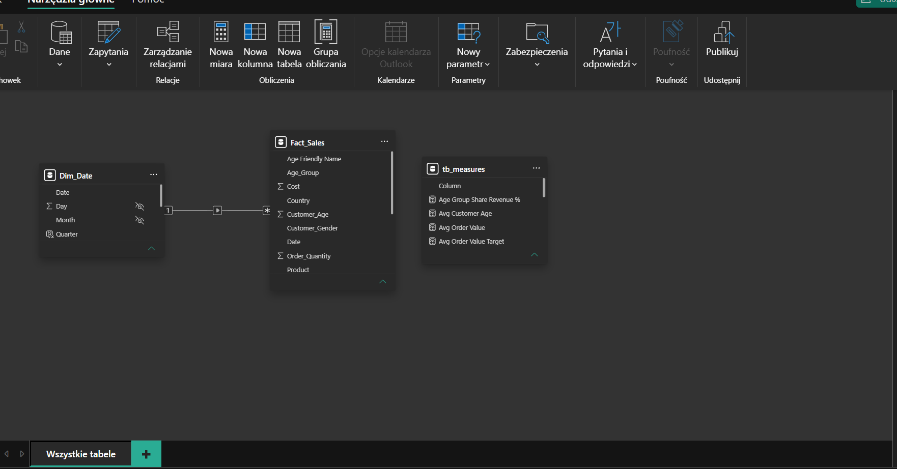
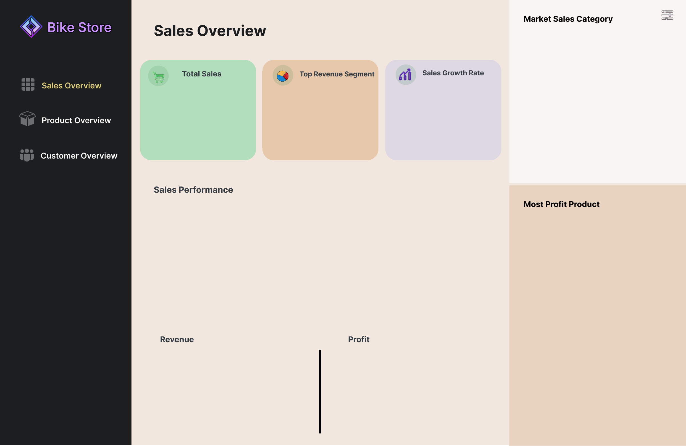
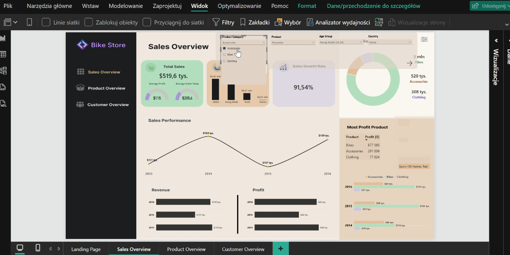
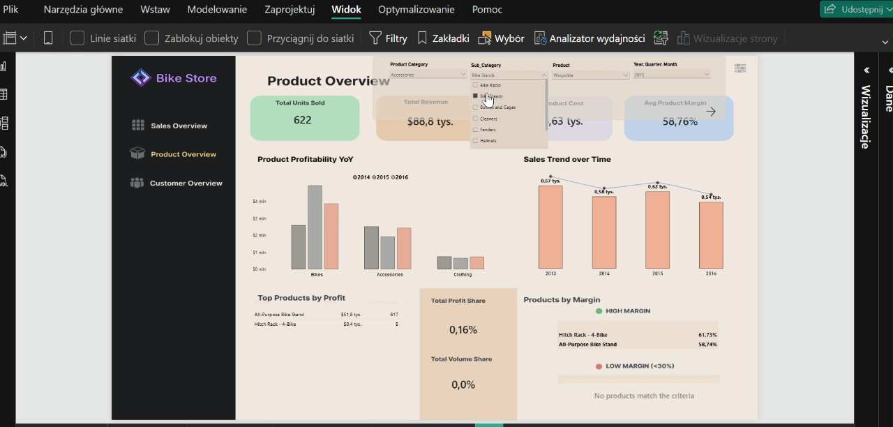
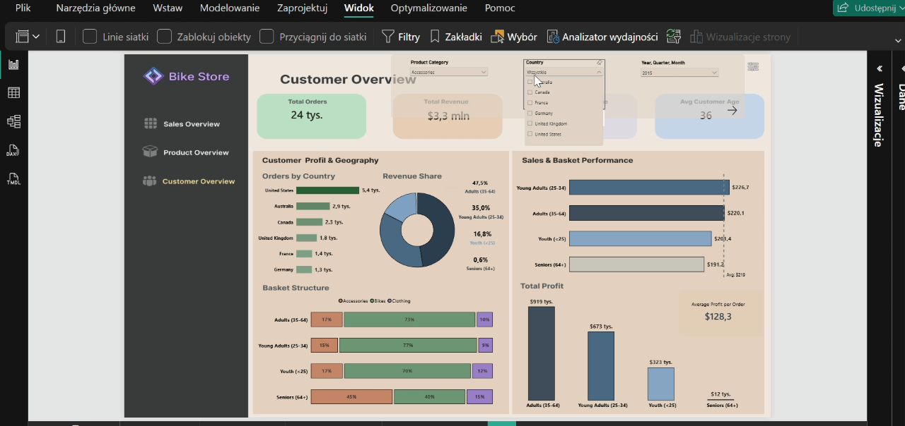

# 📊 Dashboard Power BI – Analiza Sprzedaży E-Commerce (Sklep Rowerowy)


Interaktywny, 3-stronicowy raport Power BI dedykowany analizie sprzedaży, marżowości oraz klientów dla europejskiego e-commerce w branży rowerowej (Sprzedaż, Produkt, Klient).<br> Projekt stanowi kompletne rozwiązanie BI – od surowych danych, przez modelowanie i zaawansowane miary DAX, aż po autorski layout w programie Figma.

<br>

<div align="center">

### Wybierz stronę raportu do podglądu:

<div align="center">

<a href="#strona-1">
  
</a>
<a href="#strona-2">
  
</a>
<a href="#strona-3">
  
</a>

</div>

<div align="center">


<div align="left">


<br><br>
---
### 📚 Spis treści
<div id="1-wstęp"></div>
<details>
<summary><b>1. Problem biznesowy i cele projektu</b> <i>(kliknij, aby rozwinąć)</i></summary>

<br>

Zarząd e-commerce rowerowego potrzebował **spójnego wglądu w realną rentowność produktów i klientów**, ponieważ rozproszone dane utrudniały podejmowanie decyzji o marżach i budżetach marketingowych.

**Cele:**
* Zidentyfikowanie, które linie rowerów i akcesoriów faktycznie generują zysk.
* Śledzenie dynamiki przychodów w czasie i wykrywanie sezonowości.
* Określenie profilu najbardziej wartościowego klienta i geograficznego rozkładu zamówień.
</details>

<div id="2-dane"></div>
<details>
<summary><b> 2. Dane do raportu</b> <i></i></summary>

<br>

#### a. Źródło danych
* **Pochodzenie i format danych:** Publiczny zbiór danych z platformy **Kaggle**, plik `*.csv`

#### b. Zakres 
* **Czas:** Dokładna data (dzień, miesiąc, rok)
* **Demografia:** Wiek (liczbowo oraz grupy wiekowe: *Youth*, *Adults*) i płeć klientów.
* **Geografia:** Kraj (*Country*) i region/stan (*State*).
* **Produkty:** Kategoria (*Product_Category*: rowery/akcesoria), Podkategoria (*Sub_Category*) oraz nazwa modelu (*Product*).
  
#### c. Miary finansowe
* **Wolumen i przychody:** *Order_Quantity* (sztuki), *Unit_Price*, *Revenue* (przychód).
* **Koszty i rentowność:** *Unit_Cost*, *Cost*, *Profit* (zysk)
</details>

<div id="3-model danych"></div>
<details>
<summary><b> 3. Model danych </b> <i></i></summary>

<br>

Model danych został zorganizowany wokół centralnej tabeli faktów

* **Tabela Faktów (`Fact_Sales`):** Główna tabela transakcyjna zawierająca kluczowe metryki finansowe (koszty, przychody, wolumen) oraz atrybuty klienta i produktu.
* **Tabela Wymiaru (`Dim_Date`):** Dedykowana tabela kalendarza połączona relacją jednokierunkową **1:* (Jeden do Wiele)** z tabelą faktów, umożliwiająca zaawansowaną analizę czasową (Time Intelligence).
* **Tabela Miar (`tb_measures`):** Osobna tabela techniczna służąca jako spójny kontener na wszystkie utworzone miary DAX, co ułatwia zarządzanie kodem.

<!-- Podgląd schematu relacji w Power BI -->
<p align="center">
  
</p>


</details>

<div id="4-projekt-ui-ux-figma"></div>
<details>
<summary><b> 4. Projekt widoków w Figma  </b> <i></i></summary>
<br>

Zanim powstał raport w Power BI, cały interfejs został zaprojektowany od podstaw w programie **Figma**. <br>Takie podejście pozwoliło na spójne zaplanowanie architektury informacji, hierarchii wizualnej oraz customowych elementów graficznych.

* Projekt został zrobiony na przemyślanej palecie kolorów nawiązującej do branży rowerowej (dynamiczne żółcie, głębokie błękity i zieleń analityczna).
* Stworzyłem makiety dla 3 głównych zakładek analitycznych oraz strony startowej:
  1. *Przegląd Sprzedaży* – KPI, trendy czasowe i mapy geograficzne.
  2. *Analiza Produktów* – marżowość, podkategorie i bestsellery.
  3. *Analiza Klientów* – segmentacja wiekowa, demografia i zachowania zakupowe.
  4. *Strona Start*
* Tła oraz statyczne elementy interfejsu wygenerowałem jako czyste grafiki w Figmie i importowałem w bezpośrednio do PowerBI jako tło kanwy.


#### 🎨 Makiety layoutów:

<table>
  <tr>
    <td width="50%" align="center">
      <b>Strona Startowa</b><br>
      
    </td>
    <td width="50%" align="center">
      <b>Przegląd Sprzedaży</b><br>
      
    </td>
  </tr>
  <tr>
    <td width="50%" align="center">
      <b>Analiza Produktów</b><br>
      
    </td>
    <td width="50%" align="center">
      <b>Analiza Klientów</b><br>
      
    </td>
  </tr>
</table>

<br>

</details>


</details>

<div id="5-Logika i dax"></div>
<details>
<summary><b> 5. Logika biznesowa sklepu i kluczowe miary DAX  </b> <i></i></summary>
<br>

Aby przeanalizować sprzedaż w branży rowerowej, stworzyłem dedykowany zestaw miar DAX (wykorzystujących funkcje takie jak `CALCULATE`, `ALL`, `DIVIDE` czy zmienne `VAR`).

#### 1. Całkowity przychód [$] (Total Revenue)

```dax
Total Revenue = SUM('Fact_Sales'[Revenue])
```
**Cel analityczny:** Podstawowy wskaźnik pokazujący całkowitą wartość sprzedaży wygenerowaną w danym okresie. <br>
Stanowi fundament pod dalsze wyliczenia finansowe (marża, zysk netto, AOV).

---

#### 2. Średnia wartość zamówienia [$] (Global Avg Order Value)

```dax
Global Avg Order Value = CALCULATE([Avg Order Value], ALL('Fact_Sales'[Age_Group]))
```
**Cel analityczny:** Obliczenie średniej wartości zamówienia dla całego sklepu  (całkowicie ignorując filtr grupy wiekowej). <br>
Umożliwienie bezpośredniego porównania średniej wartości koszyka konkretnej grupy wiekowej ze średnią dla całego sklepu

---

#### 3. Średnia marża produktu [$] (Avg Product Margin)

```dax
Avg Product Margin = DIVIDE([Total Profit], [Total Revenue], 0)

```
**Cel analityczny:** Kluczowy wskaźnik rentowności pozwalający ocenić, jaka część przychodu ze sprzedaży produktów zostaje w firmie jako zysk.

---

#### 4. Wskaźnik sprzedaży [%] (Sales Growth Rate)

```dax
Sales Growth Rate = 
VAR PoprzedniRok = CALCULATE([Total Revenue], SAMEPERIODLASTYEAR('Dim_Date'[Date]))
RETURN
  DIVIDE([Total Revenue] - PoprzedniRok, PoprzedniRok, 0)
```
**Cel analityczny:** Pozwala rzetelnie ocenić dynamikę wzrostu biznesu z uwzględnieniem sezonowości.

---

#### 5. Udział wolumenowy TOP produktów [%] (Top Products Volume Share)

```dax
Top Products Volume Share = 
VAR NumOfTopProducts = 10  -- Liczba produktów w tabeli w widoku raportu
-- 1. Sprzedane sztuki dla Top 10 produktów
VAR TopProductsUnits = 
    CALCULATE(
        SUM('Fact_Sales'[Order_Quantity]), 
        TOPN(
            NumOfTopProducts,
            ALL('Fact_Sales'[Product]),
            [Total Profit], --  ranking po ZYSKU
            DESC
        )
    )

-- 2. Całkowita liczba sprzedanych sztuk w całej firmie
VAR TotalCompanyUnits = 
    CALCULATE(
        SUM('Fact_Sales'[Order_Quantity]),
        ALL('Fact_Sales')
    )

RETURN
    DIVIDE(TopProductsUnits, TotalCompanyUnits, 0)
```
**Cel analityczny:** Pozwala zweryfikować zasadę Pareto (czy kluczowy zysk idzie w parze z wolumenem) oraz ocenić, jak duże jest uzależnienie sprzedaży od topowego asortymentu w sklepie rowerowym.


</details>

<div id="6-prezentacja-wynikow"></div>
<details>
<summary><b> 6. Data Storytelling & Wizualizacje (Przykłady)</b></summary>

<br>

Warstwa wizualna została zaprojektowana w oparciu o zasady Data Storytellingu. Kliknij poniżej, aby rozwinąć poszczególne widoki:

<br>

<!-- PUNKT 1 -->
<details>
<summary><b>1. Karty KPI (Widok Sprzedaż)</b></summary>
<p align="center">
    
  </p>

* **Całkowita sprzedaż i wskaźniki jednostkowe** (`Zielona karta`)
  * **Total Sales:** Główna wartość pokazująca całkowity przychód wygenerowany przez sklep w wybranym okresie.
  * **Average Profit (Gauge):** Średni zysk przypadający na jedno zamówienie.
  * **Average Order Value (Gauge):** Średnia wartość koszyka zakupowego.

  <span style="color: #4dabf7; font-weight: bold;">Cel analityczny:</span> Szybka ocena skali biznesu oraz rentowności pojedynczej transakcji.

* **Segmenty Przychodowe (`Beżowa karta`)**
  * **Wykres słupkowy:** Prezentuje rozkład przychodów sklepu rowerowego w podziale na grupy demograficzne klientów.

  <span style="color: #4dabf7; font-weight: bold;">Cel analityczny:</span> Szybka identyfikacja kluczowej grupy docelowej, która przynosi największe przychody dla biznesu.

* **Dynamika sprzedaży (`Fioletowa karta`)**
  * Sales Growth Rate: Wyrazista, pojedyncza karta KPI przedstawiająca dynamikę wzrostu przychodów w ujęciu rocznym (YoY).
    
  <span style="color: #4dabf7; font-weight: bold;">Cel analityczny:</span> Błyskawiczna informacja o tempie rozwoju oraz wysokiej skalowalności biznesu rowerowego. 
</details>

<br>

<!-- PUNKT 2 -->
<details>
<summary><b>2. Wykresy słupkowe (Widok Sprzedaż)</b></summary>
<p align="center">
    
  </p>

* **Porównanie roczne:** Przychody (Revenue) vs Zysk (Profit) w latach 2014–2016
* Dwa wykresy słupkowe obok siebie pokazują twarde zestawienie finansowe przedsiębiorstwa w ujęciu rocznym.
    
<span style="color: #4dabf7; font-weight: bold;">Cel analityczny:</span> Weryfikacja czy przychody i zysk idą w parze z realnym zyskiem przedsiębiorstwa (rentownością sprzedaży) oraz pozwalają ocenić stabilność finansową firmy na przestrzeni lat.
</details>

<br>

<!-- PUNKT 3 -->
<details>
<summary><b>3. Wykres kolumnowy grupowany (Widok Produkty)</b></summary>
<p align="center">
    
  </p>

* Wykres przedstawia rentowność poszczególnych kategorii produktów w czasie.
* Jedna wizualizacja pokazuje dwa wymiary, bez zbędnego szumu prowadzi odbiorcę do konkretnych wniosków biznesowych.
  
<span style="color: #4dabf7; font-weight: bold;">Cel analityczny:</span> Identyfikacja najbardziej dochodowych produktów oraz śledzenie dynamiki ich rentowności na przestrzeni lat.
</details>

<br>

<!-- PUNKT 4 -->
<details>
<summary><b>4. Wykres słupkowy 100% skumulowany (Widok Klient)</b></summary>
<p align="center">
    
  </p>
  
* Procentowy udział poszczególnych kategorii produktów w całkowitych wydatkach poszczególnych grup demograficznych.
* Paski procentowe i podział na kolory pozwalają w ułamku sekundy zrozumieć nawyki zakupowe bez zagłębiania się w tabele.

Cel analityczny: Zrozumienie nawyków zakupowych różnych pokoleń w celu optymalizacji ofert.

</details>

<br>

<!-- PUNKT 5 -->
<details>
<summary><b>5. Wykres kolumnowy grupowany (Widok Klient)</b></summary>
<p align="center">
    
  </p>
  
* Wykres przedstawia całkowity zysk netto wygenerowany przez poszczególne grupy wiekowe klientów.
* Wyraźne słupki uszeregowane malejąco pozwalają w ułamku sekundy zauważyć, kto napędza rentowność firmy.
  
Cel analityczny: Skierowanie działań tam, gdzie zwrot z inwestycji jest najwyższy.
</details>


<br><br><br><br><br><br><br><br>
<br><br><br><br>
<br><br><br><br>
<br><br><br><br>
<br><br><br><br>
<br><br><br><br>

<!-- Sekcja Strony 1 -->
<div id="strona-1" align="center">

### Strona 1: Ogólny Przegląd Sprzedaży



<a href="#">
  
</a>
</div>

<br>


<!-- Sekcja Strony 2 -->
<div id="strona-2" align="center">

### Strona 2:  Analiza Produktów



<a href="#">
  
</a>
</div>

<br>

<!-- Sekcja Strony 3 -->
<div id="strona-3" align="center">

### Strona 3:  Analiza Klientów



<a href="#">
  
</a>
</div>

<br>


